# Viking Transport

🇬🇧 [English version](README.md)

Application web pour un réseau fictif de cars régionaux en Normandie, réalisée en équipe pendant ma 2ème année de BUT Informatique à l'IUT Grand Ouest Normandie (Caen).

Les clients peuvent consulter le réseau, calculer des itinéraires avec correspondances, réserver des trajets en plusieurs étapes et cumuler des points de fidélité. Les administrateurs gèrent les clients, les lignes et les horaires, et consultent des statistiques.

> ⚠️ **État du projet :** l'application s'appuyait sur une base de données Oracle hébergée sur le réseau de l'université, aujourd'hui supprimée. Le site ne peut donc plus être lancé tel quel : le code est publié à titre de référence, avec des captures d'écran de l'application en fonctionnement. Les identifiants de la base de données ont été remplacés par des valeurs d'exemple.

## Captures d'écran

| Accueil | Lignes du réseau |
|---|---|
| 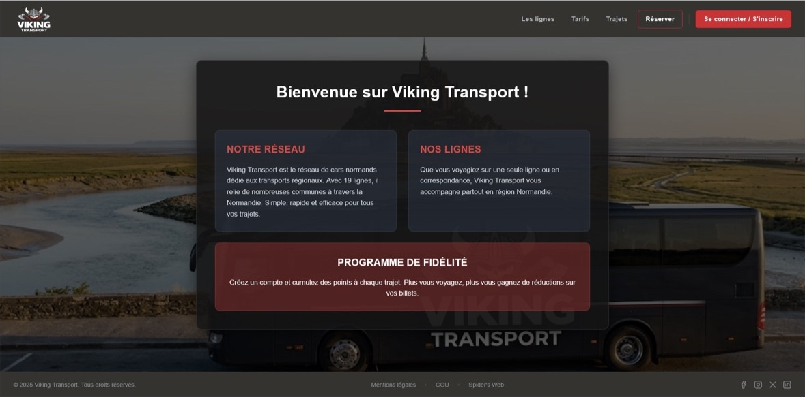 | 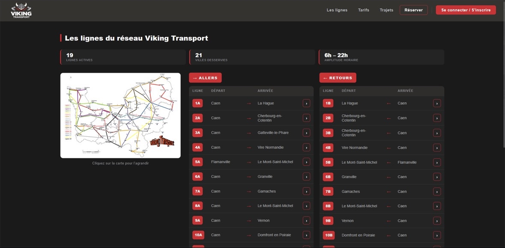 |

| Tarifs et niveaux de fidélité | Calcul d'itinéraire avec correspondances |
|---|---|
| 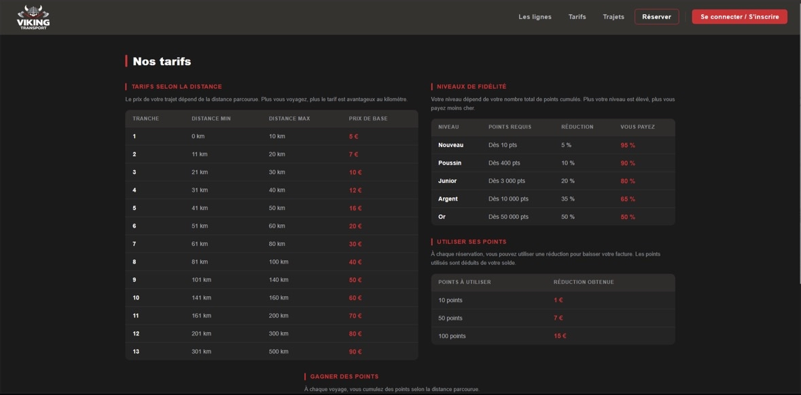 | 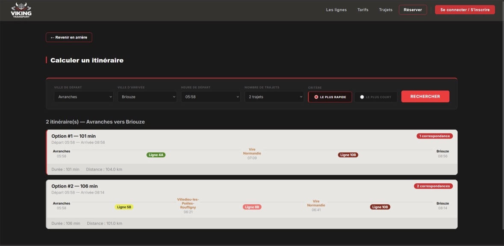 |

| Réservation en plusieurs étapes | Billet |
|---|---|
| 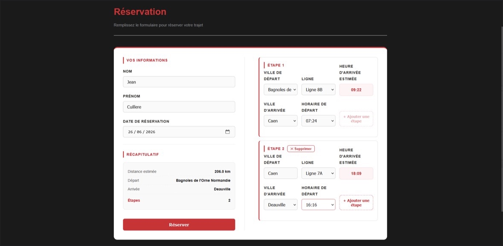 | 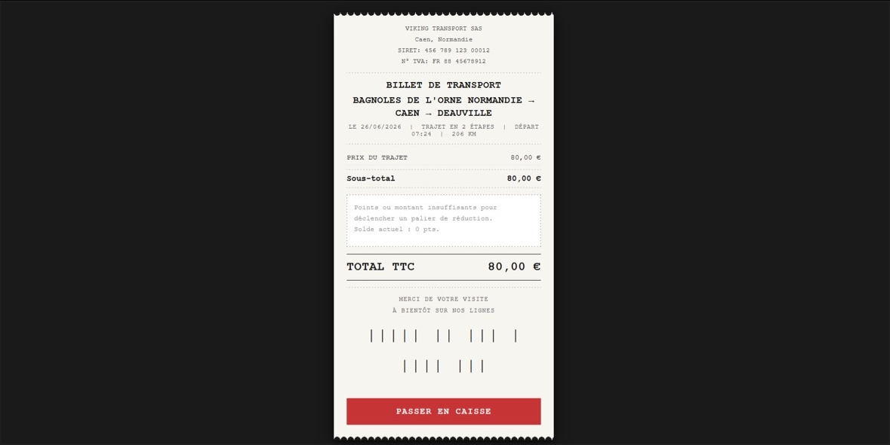 |

| Administration | Édition des lignes et horaires |
|---|---|
| 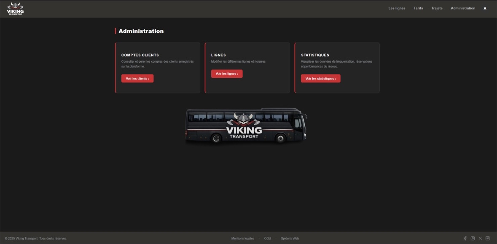 | 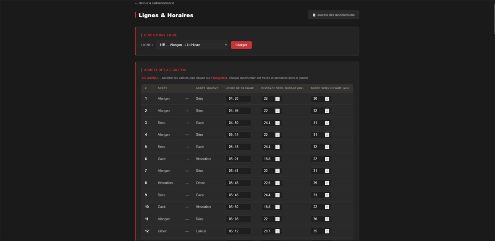 |

| Profil client | Statistiques |
|---|---|
| 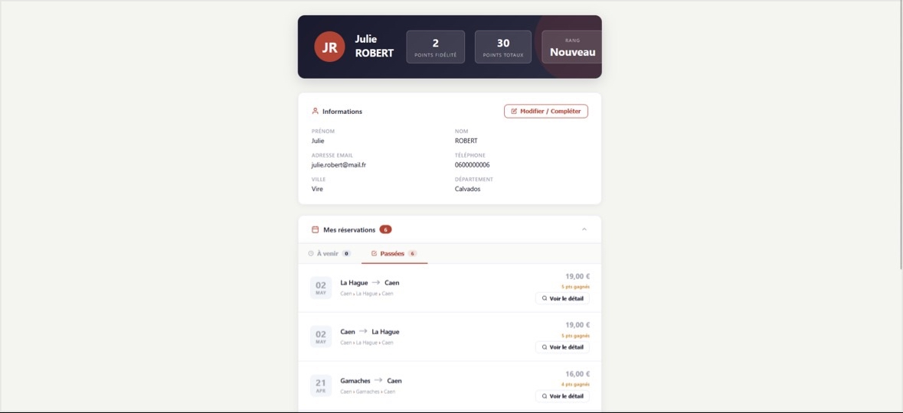 | 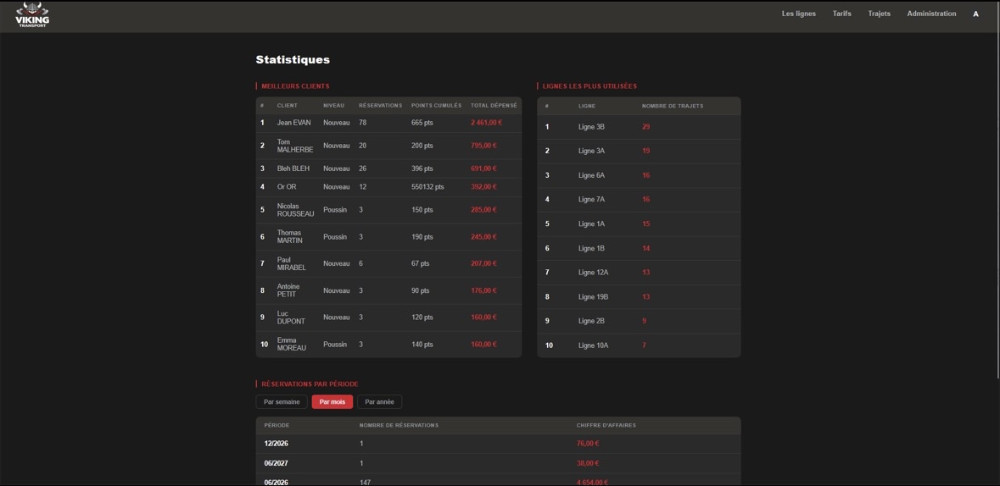 |

| Connexion |
|---|
| 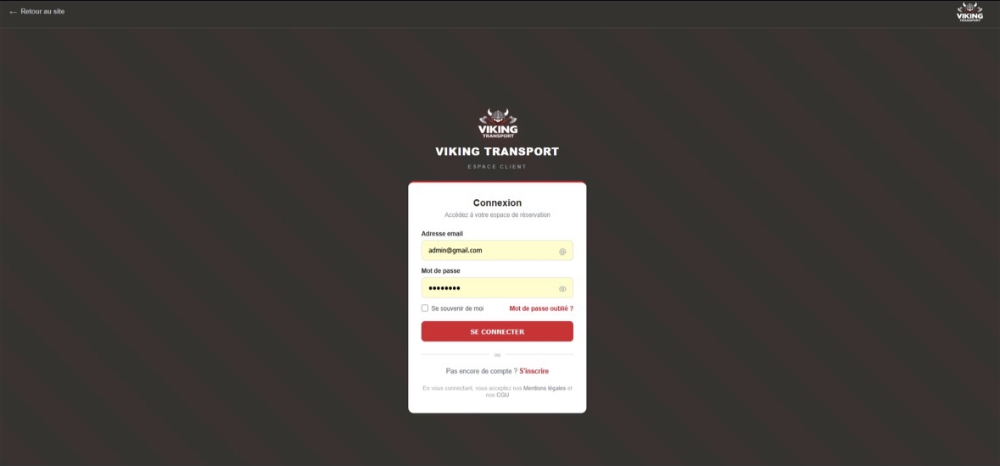 |

Les noms, adresses e-mail et chiffres visibles sur les captures sont des données de test.

## Fonctionnalités

**Côté client**
- Consultation des 19 lignes du réseau (allers et retours) et des villes desservies
- **Calcul d'itinéraire** avec correspondances, au choix le plus rapide ou le plus court
- **Réservation en plusieurs étapes** avec heure d'arrivée estimée et récapitulatif (distance, étapes)
- **Billet** avec le prix du trajet
- **Tarification selon la distance** (13 tranches)
- **Programme de fidélité** : points gagnés à chaque trajet, cinq niveaux (Nouveau, Poussin, Junior, Argent, Or) avec des réductions croissantes, et points utilisables pour obtenir une réduction
- Création de compte et connexion, avec une page de profil qui liste les réservations passées et à venir

**Côté administrateur**
- Tableau de bord donnant accès aux clients, aux lignes et aux statistiques
- **Gestion des clients** (recherche, tri, modification)
- **Édition des lignes et horaires** : heures de passage, distances et durées
- **Journal des modifications** avec possibilité de restaurer une valeur précédente
- **Statistiques** : meilleurs clients, lignes les plus utilisées, réservations et chiffre d'affaires par semaine, mois ou année

## Technologies

- **PHP** (logique serveur, sessions)
- **JavaScript** (formulaire de réservation dynamique, recherche d'itinéraire, validation)
- **HTML / CSS**
- Base de données **Oracle**, accessible via **PDO** (pilote `oci`)
- Déployé sur un serveur Apache (`.htaccess`)

## Structure du projet

```
.
├── index.php                 # Page d'accueil
├── .htaccess
├── Pages/                    # Pages et traitements de formulaires
│   ├── ligne.php, horaire.php, tarif_accueil.php, trajet.php
│   ├── tarif_reserv.php, reserv_sansconnexion.php, traitement_reservation.php
│   ├── connexion.php, inscription.php, profil.php
│   ├── admin.php, admin_client.php, admin_clients.php
│   ├── admin_lignes.php, admin_logs.php, admin_statistiques.php
│   ├── traitement_*.php      # Traitement des formulaires
│   └── cgu.php, mentions-legales.php
├── PHP/                      # Fonctions communes et points d'accès aux données
│   ├── utils.php             # Connexion à la base et fonctions de requête
│   ├── get_lignes.php, get_arrets.php, get_horaires.php
│   ├── get_destinations.php, get_distance.php, get_heure_arrivee.php
│   └── logout.php
├── Scripts/                  # JavaScript côté client
├── CSS/                      # Une feuille de style par page
├── Files/                    # Images et logos
└── screenshots/              # Captures d'écran de ce README
```

## Configuration

La connexion à la base de données est configurée dans trois fichiers. Les identifiants ont été retirés du code publié et remplacés par des valeurs d'exemple :

- `PHP/utils.php` : utilisateur, mot de passe et DSN de la base
- `Pages/itinéraires.php` : hôte, nom du service, utilisateur et mot de passe de la base
- `Pages/traitement_connexion.php` : e-mail et mot de passe de l'administrateur

Pour relancer le projet, il faudrait fournir sa propre base Oracle (ou adapter la connexion PDO à une autre base comme MySQL), recréer les tables et renseigner ces valeurs. **Ne publie jamais de vrais identifiants.** Le schéma de la base n'est pas inclus.

## Équipe

Projet réalisé par le groupe 4 (BUT Informatique, 2ème année) : **Mathéo Rimbault** et les autres membres du groupe (à compléter).

## Remarques

Les pages légales (CGU et mentions légales) et les informations de l'entreprise affichées sur le billet sont fictives et rédigées dans le cadre du projet scolaire.
