# Viking Transport

🇫🇷 [Version française](README.fr.md)

A web application for a fictional regional coach network in Normandy, built as a team project during my 2nd year of a BUT Informatique (Bachelor of Technology in Computer Science) at the IUT Grand Ouest Normandie, Caen.

Customers can browse the network, compute itineraries with connections, book multi-leg trips and earn loyalty points. Administrators can manage clients, lines and timetables, and view statistics.

> ⚠️ **Project status:** the application relied on an Oracle database hosted on the university network, which has since been shut down. The app can no longer be run as is, so the code is published for reference, together with screenshots of the working application. The database credentials in the code have been replaced with placeholders.

## Screenshots

| Home | Network lines |
|---|---|
| 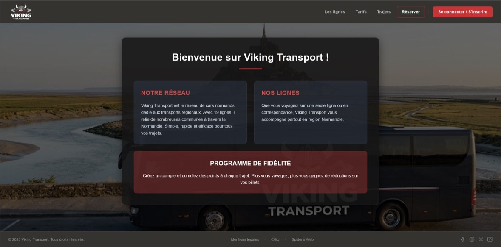 | 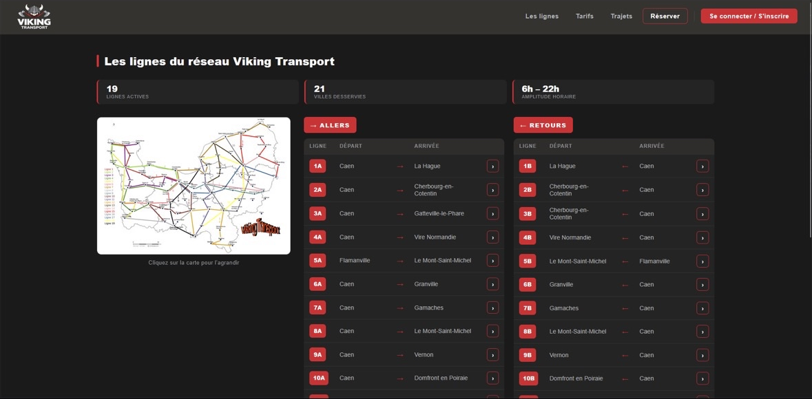 |

| Fares and loyalty levels | Itinerary search with connections |
|---|---|
| 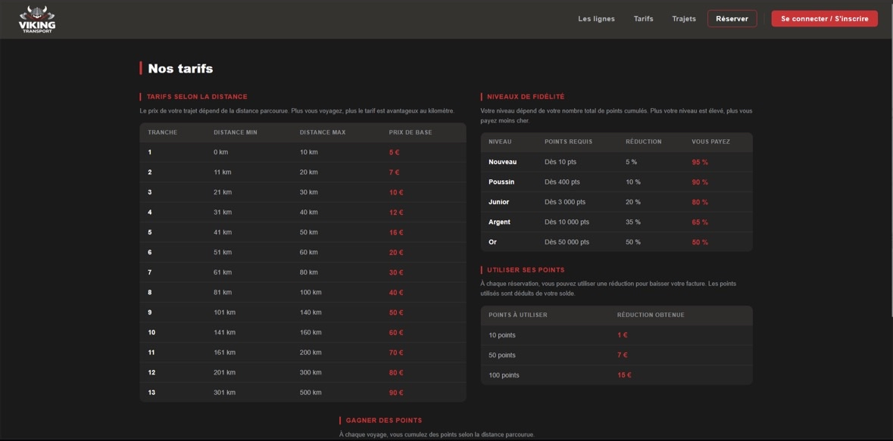 | 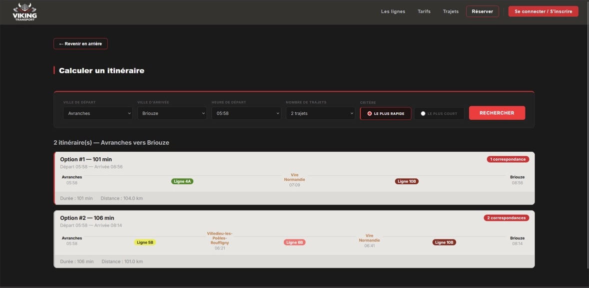 |

| Multi-leg booking form | Ticket |
|---|---|
| 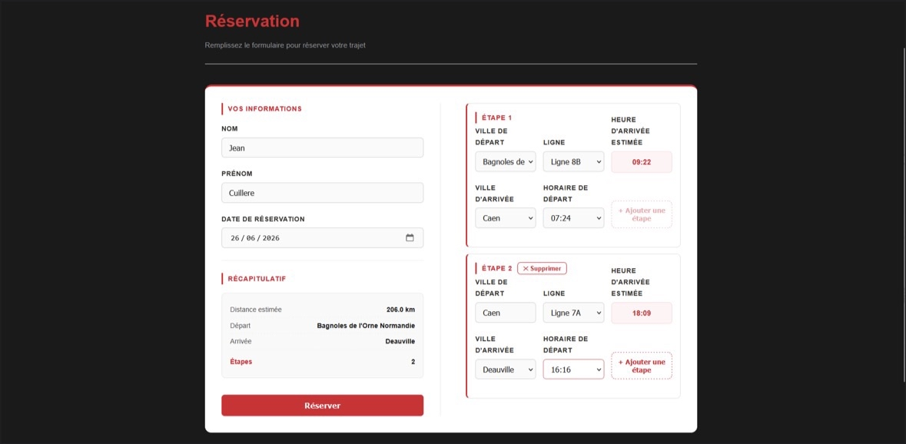 | 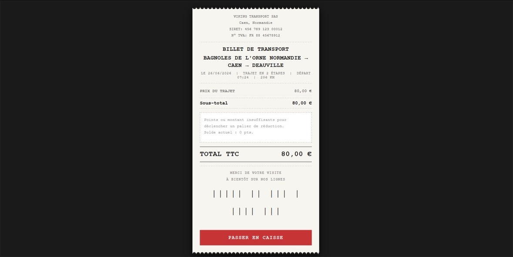 |

| Administration | Lines and timetables editor |
|---|---|
| 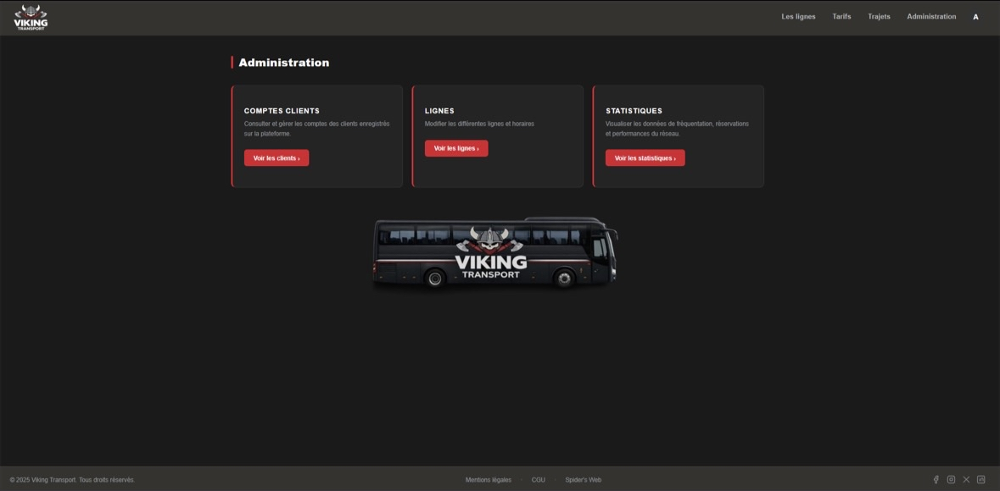 | 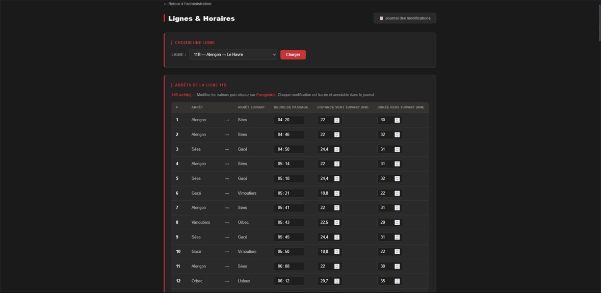 |

| Client profile | Statistics |
|---|---|
| 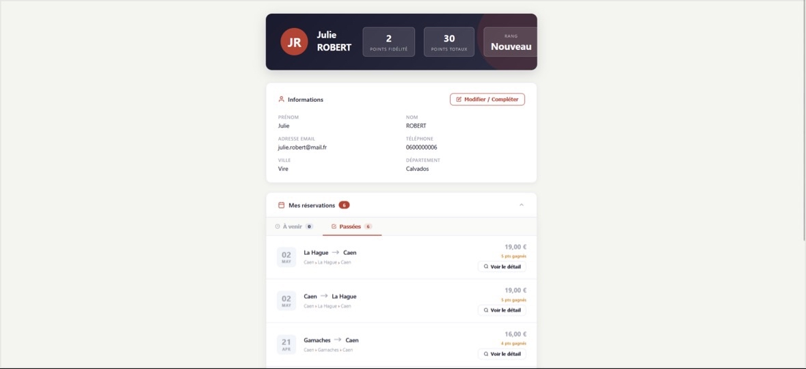 | 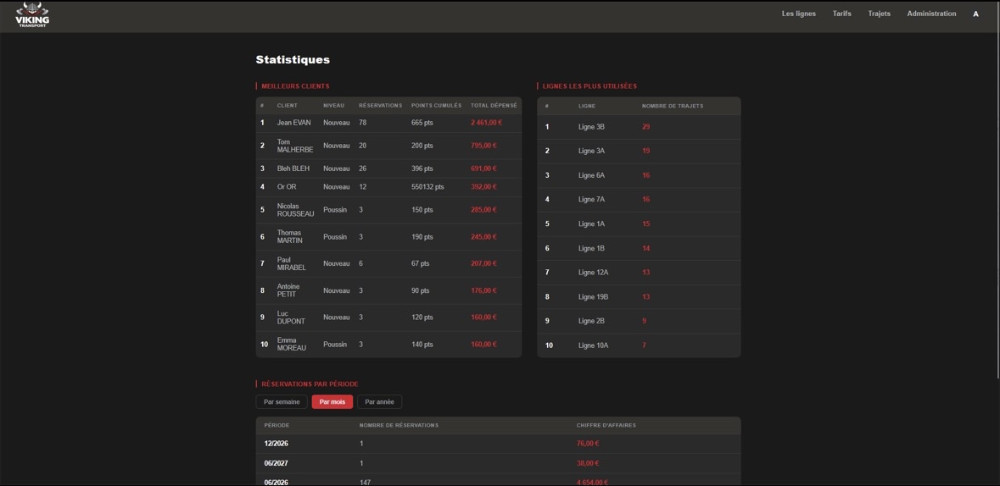 |

| Login |
|---|
| 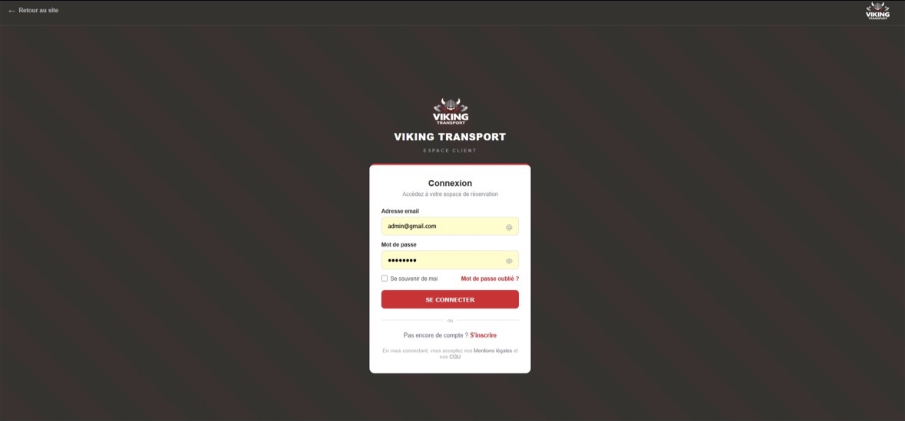 |

All names, e-mail addresses and figures shown in the screenshots are test data.

## Features

**For customers**
- Browse the 19 lines of the network (outbound and return) and the cities served
- **Itinerary calculator** with connections, with a choice between the fastest and the shortest route
- **Multi-leg booking** with estimated arrival times and a trip summary (distance, stops)
- Printable-style **ticket** with the price of the trip
- **Distance-based pricing** (13 fare bands)
- **Loyalty programme**: points earned per trip, five levels (Nouveau, Poussin, Junior, Argent, Or) with increasing discounts, and points that can be spent for a reduction
- Account creation and login, with a profile page showing past and upcoming bookings

**For administrators**
- Dashboard with access to clients, lines and statistics
- **Client management** (search, sort, edit)
- **Lines and timetables editor**: stop times, distances and durations
- **Change log** of every modification, with the ability to restore a previous value
- **Statistics**: best clients, most used lines, bookings and revenue by week, month or year

## Technologies

- **PHP** (server-side logic, sessions)
- **JavaScript** (dynamic booking form, itinerary search, form validation)
- **HTML / CSS**
- **Oracle database**, accessed through **PDO** (`oci` driver)
- Deployed on an Apache server (`.htaccess`)

## Project structure

```
.
├── index.php                 # Home page
├── .htaccess
├── Pages/                    # Pages and form handlers
│   ├── ligne.php, horaire.php, tarif_accueil.php, trajet.php
│   ├── tarif_reserv.php, reserv_sansconnexion.php, traitement_reservation.php
│   ├── connexion.php, inscription.php, profil.php
│   ├── admin.php, admin_client.php, admin_clients.php
│   ├── admin_lignes.php, admin_logs.php, admin_statistiques.php
│   ├── traitement_*.php      # Form processing
│   └── cgu.php, mentions-legales.php
├── PHP/                      # Shared helpers and data endpoints
│   ├── utils.php             # Database connection and query helpers
│   ├── get_lignes.php, get_arrets.php, get_horaires.php
│   ├── get_destinations.php, get_distance.php, get_heure_arrivee.php
│   └── logout.php
├── Scripts/                  # Front-end JavaScript
├── CSS/                      # One stylesheet per page
├── Files/                    # Images and logos
└── screenshots/              # Screenshots used in this README
```

## Configuration

The database connection is configured in three files. Credentials were removed from the published code and replaced with placeholders:

- `PHP/utils.php`: database user, password and DSN
- `Pages/itinéraires.php`: database host, service name, user and password
- `Pages/traitement_connexion.php`: administrator e-mail and password

To run the project you would need to provide your own Oracle database (or adapt the PDO connection to another database such as MySQL), recreate the tables, and fill in these values. **Never commit real credentials.** The database schema is not included.

## Team

This project was developed by Group 4, consisting of 8 second-year BUT Informatique students.

## Notes

The legal pages (terms of use and legal notices) and the company information shown on the ticket are fictional and written for the purpose of the school project.
